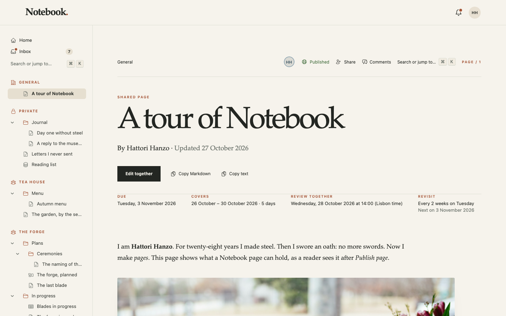
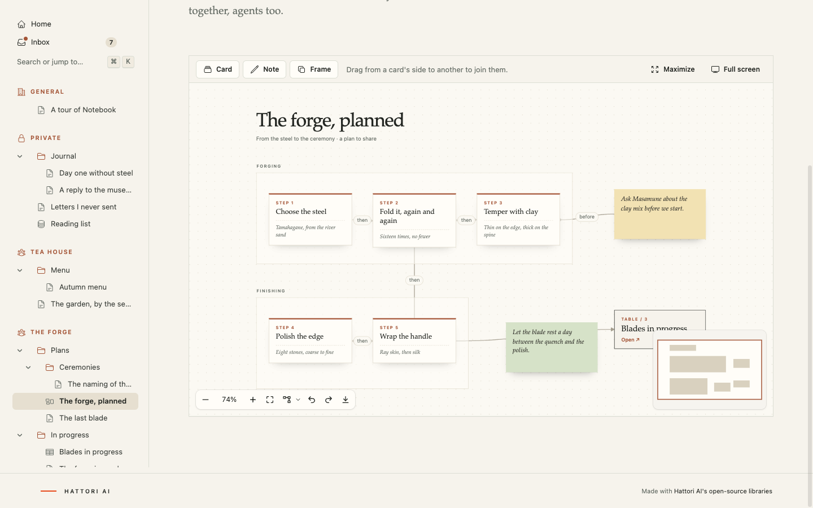
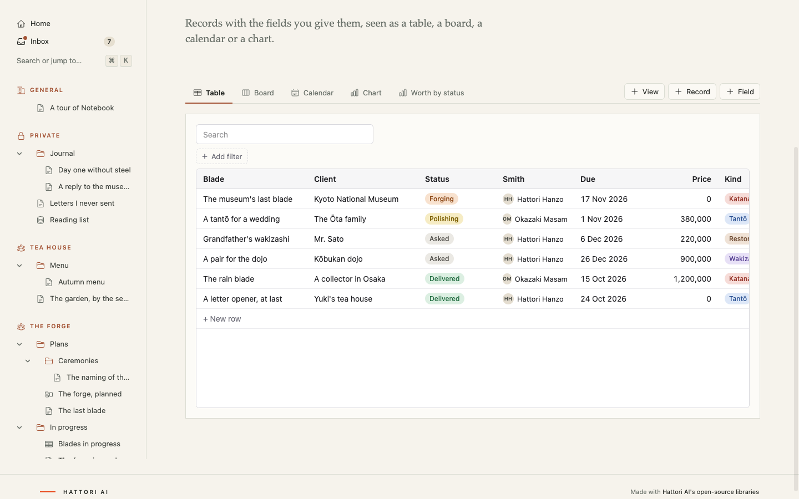

# Notebook


**A notebook for your team that you actually own.**

Write pages, sketch plans on boards, keep tables and databases, and work on all of it together, live. Bring your AI agents in too: they work on the same pages beside you, where everyone can see them. Notebook runs on one small server of yours and keeps everything in one SQLite file. Nobody charges you per seat, and nobody else reads your notes.



## Why you might want it

Most team wikis rent your own notes back to you, a seat at a time, and keep them on someone else's computer. Notebook is the other way round.

- **It's all yours.** One app, one database file. Back it up by copying a file, move it to another server in an afternoon, read it with any SQLite tool. Your notes don't depend on a company's pricing page.
- **It's made for working together.** Every page is a live room. You see who's there, their cursors and pointers, and their changes as they make them, in a text, on a board or in a table.
- **Your agents are teammates, not a chat window.** Connect Claude Code or Codex and your agent edits the same pages in plain sight: its cursor in the text, its cards on the board, its name in the list of people, with **Pause** and **Stop** for anyone. It can only do what you can do, and a page or a space can be off limits to agents entirely.
- **It's small.** No Redis, no Postgres, no queue to run. A server of a few euros a month holds a team's notebook, and other apps beside it.

## What's inside

- **Four kinds of page.** Texts with images, galleries, PDFs and video. Boards of cards, notes and arrows. Tables you edit like a spreadsheet. Databases with the fields you choose, seen as a table, a board, a calendar or a chart.
- **Spaces.** One for everyone, a private one for each person, and team spaces with members and roles. Give each space an icon, an emoji, or your own image. Share a single page or folder with someone, or with a link.
- **Comments and mentions** on whatever you select: a sentence, a card, a cell. Mention a person, or someone's agent.
- **An Inbox** of what concerns you, a bell, and an email if you haven't read it yet.
- **Search and a command palette (⌘K)** for every page and every action.
- **Publishing.** Put any page on the web, or a folder as a blog with a feed, even at an address of your own.
- **Bots.** Admins can set up the notebook's own assistants, powered by Claude, that answer when mentioned, pick up tasks, or run on a schedule, within a monthly budget.
- **Your rules.** Invite-only sign-ups, and files kept on the server or in any S3-compatible bucket.





## Try it in two minutes

You need Elixir 1.18 or later.

```sh
git clone https://github.com/hattoriai/notebook.git
cd notebook
mix setup
mix phx.server
```

Open <http://localhost:4000>. The sample notebook belongs to Hattori Hanzo, a retired swordsmith who now makes pages, and two friends of his. Sign in as any of them:

| Who | Email | Password |
| --- | --- | --- |
| Hattori Hanzo, the notebook's admin | `hanzo@notebook.test` | `no more swords` |
| Okazaki Masamune, an old friend who still makes blades | `masamune@notebook.test` | `the sharpest pen` |
| Yuki Hattori, his last apprentice, who now keeps a tea house | `yuki@notebook.test` | `my first page` |

The best first thing to try: open the same page as two of them, in two browsers, side by side. Then [take the tour](guides/tour.md) for everything else.

## Host it yourself

The repository comes ready to deploy with [Kamal](https://kamal-deploy.org) to any Linux server you can SSH into: it builds the app, gets an HTTPS certificate, and keeps the database and uploads on a volume. In short:

1. Get a small server, and point your domain's DNS at it.
2. Copy `.kamal/secrets.example` to `.kamal/secrets` and fill it in.
3. Run `kamal setup` once, then `kamal deploy` whenever you update.

The first account to sign up becomes the admin. From **Notebook settings** you can make sign-ups invite-only, choose where files are kept, and decide how agents connect.

Backups are one command: `sqlite3 /data/notebook.db ".backup copy.db"`, plus the uploads folder. The [self-hosting guide](guides/self-hosting.md) has every step and setting.

## Bring your agents

Open **Agents** in the sidebar, give your agent a name, and copy the command it gives you:

```sh
claude mcp add --transport http notebook "https://your-notebook/mcp?token=…"
```

Then open a page and ask: *"Add a card for each step of the ceremony to the board, and join them in order."* You'll watch it happen.

Your agent keeps a memory of its own, which you can read and correct. An admin can also let people sign in from their client with OAuth instead of a token, and switch between their agents as they work. See [agents and bots](guides/agents.md).

## Made with Hattori AI's open source

Notebook is also a showcase. Each of its parts is an open-source library for Phoenix, and you can use any of them in your own app:

| Library | What it does in Notebook |
| --- | --- |
| [Issho](https://github.com/hattoriai/issho) | Each page is a live room: who's there, their pointers, their changes, and the agents beside them |
| [Kotoba](https://github.com/hattoriai/kotoba) | The rich text editor |
| [Hakushi](https://github.com/hattoriai/hakushi) | Boards of cards and arrows |
| [Masu](https://github.com/hattoriai/masu) | Tables, edited cell by cell |
| [Cardbox](https://github.com/hattoriai/cardbox) | Databases with your own fields |
| [Koyomi](https://github.com/hattoriai/koyomi) | Dates, ranges and repeats |
| [Jumon](https://github.com/hattoriai/jumon) | The command palette |
| [Erabi](https://github.com/hattoriai/erabi) | Every picker: people, roles, emoji and icons |
| [Narabe](https://github.com/hattoriai/narabe) | The sidebar's order, by drag and drop |
| [Fude](https://github.com/hattoriai/fude) | Charts |
| [Sekisho](https://github.com/hattoriai/sekisho) | Who may read, comment on or edit what |
| [Chime](https://github.com/hattoriai/chime) | The Inbox, the bell and the emails |
| [Storehouse](https://github.com/hattoriai/storehouse) | Uploads, on disk or in a bucket |
| [Sake](https://github.com/hattoriai/sake) | The MCP server your agents connect to |

## Guides

- [A tour of Notebook](guides/tour.md): everything to try in the sample notebook
- [Agents and bots](guides/agents.md): connecting agents, their memory and tools, and the notebook's own bots
- [Self-hosting](guides/self-hosting.md): deploying with Kamal, files, secrets and backups
- [Publishing](guides/publishing.md): pages and blogs at an address of your own
- [Development](guides/development.md): running the checks, and trying unreleased library changes
